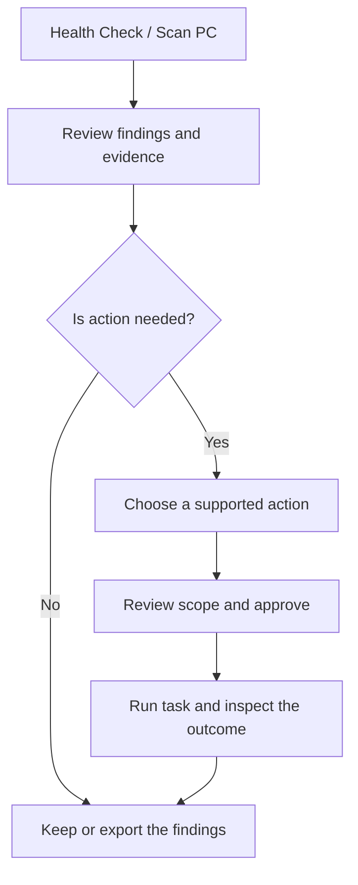
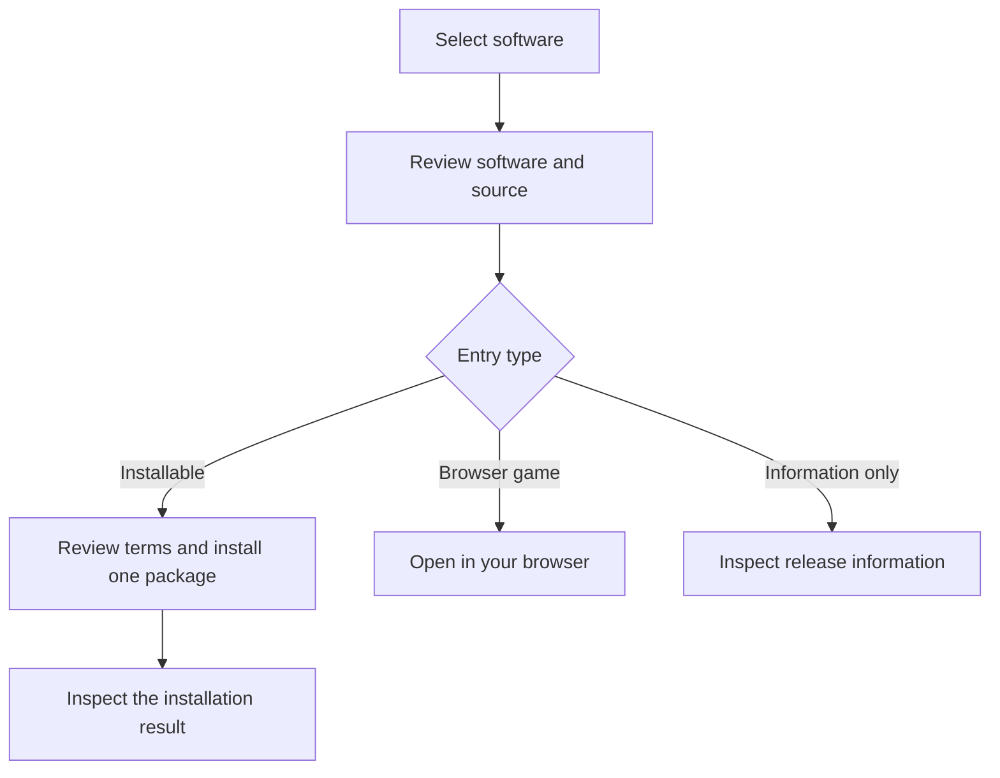

# 🛡️ FORGE SENTINEL

### Know your PC. Understand the problem. Choose the action.

**Architecture-grade software production**  
by **CodeLineCore**

**Windows x64 · Portable & Installable · Licence Required**

[⬇ Download Forge Sentinel](https://github.com/Beans-Melon/Forge-Sentinel-Releases/releases) · [📋 Release History](https://github.com/Beans-Melon/Forge-Sentinel-Releases/releases)

---

## Your PC maintenance workspace

Forge Sentinel brings Windows diagnostics, storage analysis, reviewed cleanup, backups and maintenance tools into one interface.

Whether you want to understand a slowdown or collect evidence for an IT investigation, FS helps you inspect what is happening and decide what to do next.

> **Inspect first. Review the scope. Approve specific actions.**

Opening a diagnostic tool does not automatically approve repairs or delete files.

## ⚡ What can FS help you do?

| Your goal | Tools inside FS |
|---|---|
| **Understand a slow PC** | Resource Monitor, Live processes, Performance recorder |
| **Find what consumes storage** | Disk analyzer, Duplicate files |
| **Review unnecessary caches** | Reviewed cache cleaning, Windows component cleanup |
| **Protect important files** | Verified file backup, System backup |
| **Investigate Windows problems** | Health Check, Scan PC, Crash investigator |
| **Run Windows repairs** | DISM → SFC repair |
| **Request antivirus scans** | Defender quick, Defender full |
| **Investigate startup activity** | Startup analyser |
| **Install useful applications** | Get apps |
| **Review supported software updates** | Software updates |
| **Remove applications** | Software uninstall |
| **Inspect hardware and peripherals** | Hardware details, External devices, Driver updates |
| **Check laptop or handheld batteries** | Battery status |
| **Investigate storage devices** | Drive health, USB capacity / tests |
| **Inspect connectivity** | Network & devices, Open speed test |
| **Configure supported network controls** | DNS settings, Network control |
| **Manage direct HTTPS downloads** | Download manager |
| **Plan recurring maintenance** | Maintenance schedules |

## 🔎 From a finding to an informed action

**Scan PC** collects inventory and status. Repairs, cleanup and antivirus scans are separate actions.

## 🖥️ Watch real activity

### Resource Monitor

View live CPU, memory, GPU, disk and network activity through FS’s own interface, with detailed views for processes, disks, adapters and TCP endpoints.

### Performance recorder

Capture resource samples, available sensor readings, bookmarks and process context. Review saved sessions when investigating intermittent slowdowns.

### Battery status

Inspect supported battery information, including:

- Charge percentage and AC connection.
- Charging state and battery saver.
- Reported design and full-charge capacity.
- Estimated battery health and wear.
- Cycle count, voltage and other available readings.
- Snapshot export and Windows battery-report creation.

Unavailable readings remain unavailable. Battery health is a capacity estimate, not a remaining-life guarantee.

## 🗂️ Understand and protect your storage

### Disk analyzer

Find large folders and understand logical storage usage before deciding what to remove.

### Reviewed cache cleaning

Review supported Windows, browser and application cache categories, exclusions and previews before approving cleanup.

### Duplicate files

Review supported personal assets and static files using:

**File size → SHA-256 → Full byte comparison**

Nothing is selected automatically. A keeper is protected, and approved duplicate copies go to the Windows Recycle Bin.

Source code, executables, DLLs and other excluded content remain outside the duplicate scanner’s intended scope.

### Verified file backup

Create versioned file-copy jobs with SHA-256 destination verification, checkpointed resume and saved-backup rechecking.

Independent-backup mode requires another physical disk.

### Drive and USB tools

Inspect available drive-health evidence, run supported USB tests and use safe-eject assistance.

Basic recovery supports selected JPEG, PNG and PDF signature candidates. USB-volume imaging lets you work from a copy saved to another physical disk.

> Capacity tests write data: use an empty, backed-up drive. Recovery results depend on the device and whether data has been overwritten or erased by TRIM.

## 🧰 Windows maintenance with visible results

- **Health Check** — explained findings and selected, approved fixes.
- **DISM → SFC repair** — separate repair stages, output and outcome evidence.
- **Startup analyser** — startup entries and available boot evidence.
- **Crash investigator** — grouped events and local dump evidence.
- **Defender quick / Defender full** — scans performed by Microsoft Defender.
- **Software uninstall** — supported uninstallers and reviewed eligible leftovers.
- **History / logs** — records for troubleshooting and follow-up.

Driver discovery does not automatically install every driver or flash BIOS firmware. Uninstallation does not promise removal of every shared component or registry trace.

## 📦 Get useful apps

Open **SYSTEM → Get apps** to explore the reviewed catalog.

The catalog includes productivity, media, development, utilities and entertainment entries.

Third-party terms, accounts and charges still apply. Some browser games require your own game files. Inspecting a GitHub release does not automatically execute its assets.

## 🧭 Where to find everything

| Main tab | Purpose |
|---|---|
| **START** | Health Check, Scan PC and maintenance scheduling |
| **STORAGE** | Storage analysis, cleanup, duplicate review and backups |
| **SYSTEM** | Windows repair, software, startup, crashes and protection |
| **DEVICES** | Hardware, batteries, resource monitoring, drives and USB tools |
| **NETWORK** | Connections, speed testing, DNS, controls and downloads |
| **ABOUT** | Product information and FS update checks |

**Button help:** hover over a button, or focus it and press **F1**.

## 🚀 Getting started

1. Open [Releases](https://github.com/Beans-Melon/Forge-Sentinel-Releases/releases).
2. Download the uploaded Windows ZIP or Setup executable.
3. For portable use, extract the complete ZIP and run `Forge-Sentinel.exe`. For an installed copy, run Setup.
4. Activate through **Licence / activation**.
5. Begin with **START → Health Check** or **Scan PC**.
6. Review the findings before selecting maintenance actions.

The supplied Windows build does not require Python or a separate .NET installation.

GitHub’s automatically generated **Source code** archives are not the Windows application.

## 🔔 Background operation

Closing the main window normally hides FS in the notification area so supported tasks can continue.

- Restore FS from its tray icon.
- Use **tray menu → Exit** to close it completely.
- Use **Mute task sound** to silence completion audio.
- Configure supported startup options through **Settings**.
- Configure recurring rules through **Maintenance schedules**.

Hiding the window does not cancel a task. Use its supported Stop or Cancel control and wait for the outcome.

## 🔄 Updating Forge Sentinel

1. Finish active tasks.
2. Exit the old version through its tray menu.
3. Download the new package from Releases.
4. Run Setup or extract the complete new portable package.
5. Confirm the version in the title bar or About window.

Activation is designed to persist across versions on the **same PC and Windows user profile**. Hardware identity changes or a Windows reinstall may require an administrator reset.

FS update notifications offer a download; they do not automatically replace the application. Preview releases may not appear as the latest stable update.

## 📌 Release and privacy notes

This README describes **v0.44 preview**. Features depend on the downloaded build, Windows, hardware, permissions and organisation policy.

The documented preview is unsigned. Actual Windows hardware, UI/DPI and installer acceptance testing remains necessary.

Licensing, release checks, software downloads and selected network tools contact online services. Review exported reports before sharing: they may contain paths, hardware identifiers, process details or network information.

FS does not guarantee performance gains, complete malware detection or successful file recovery. Keep independent backups.

## 💬 Feedback

When reporting a problem, include:

- FS version and Windows version.
- The exact button or task used.
- Expected behaviour and actual result.
- A reviewed screenshot or relevant log excerpt.

**Never include licence keys or administrator tokens in a public report.**

Product enquiries: **forgesentinel26@gmail.com**

---

**FORGE SENTINEL · by CodeLineCore**

*Architecture-grade software production*

[⬇ Explore Downloads & Releases](https://github.com/Beans-Melon/Forge-Sentinel-Releases/releases)

