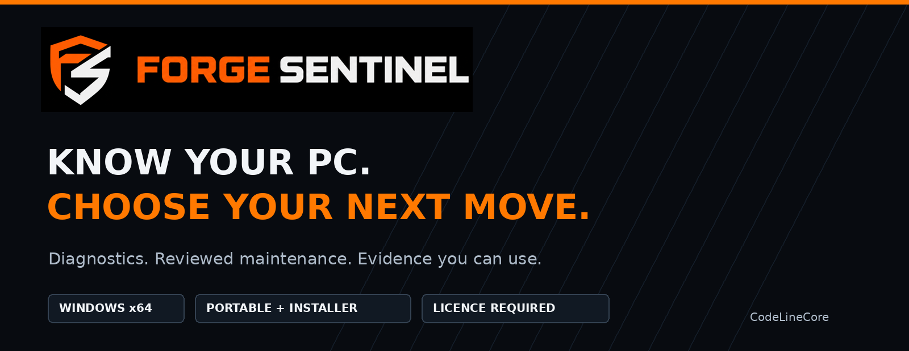
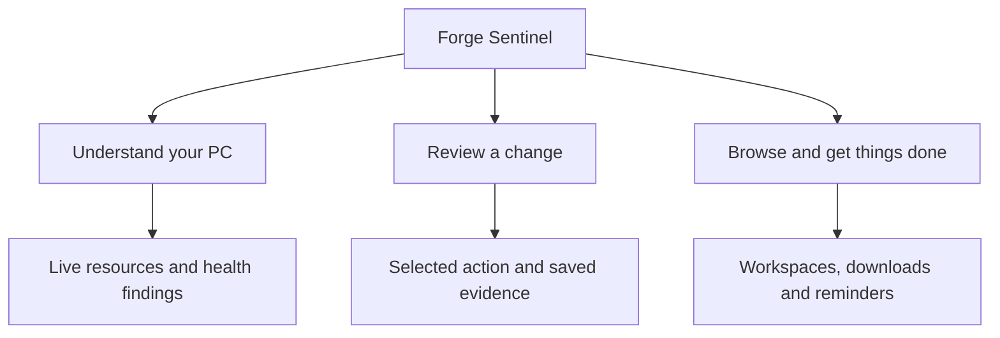
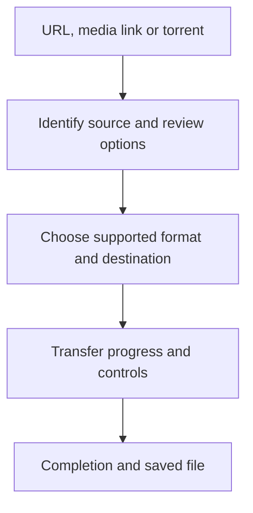
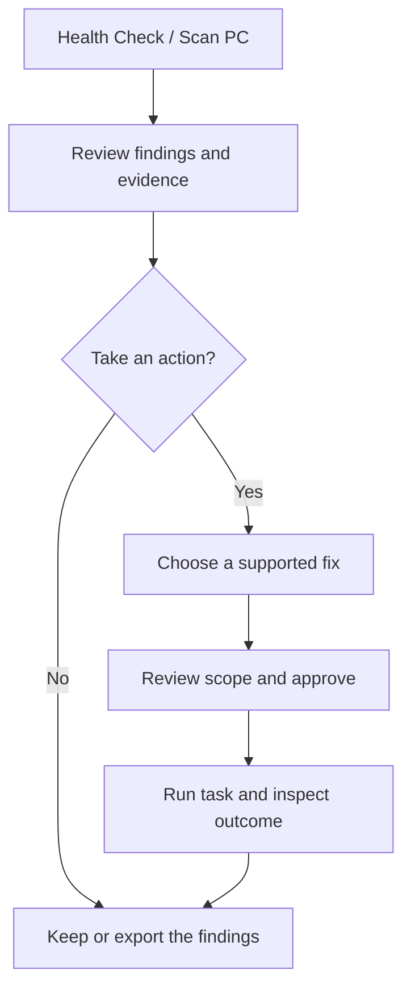
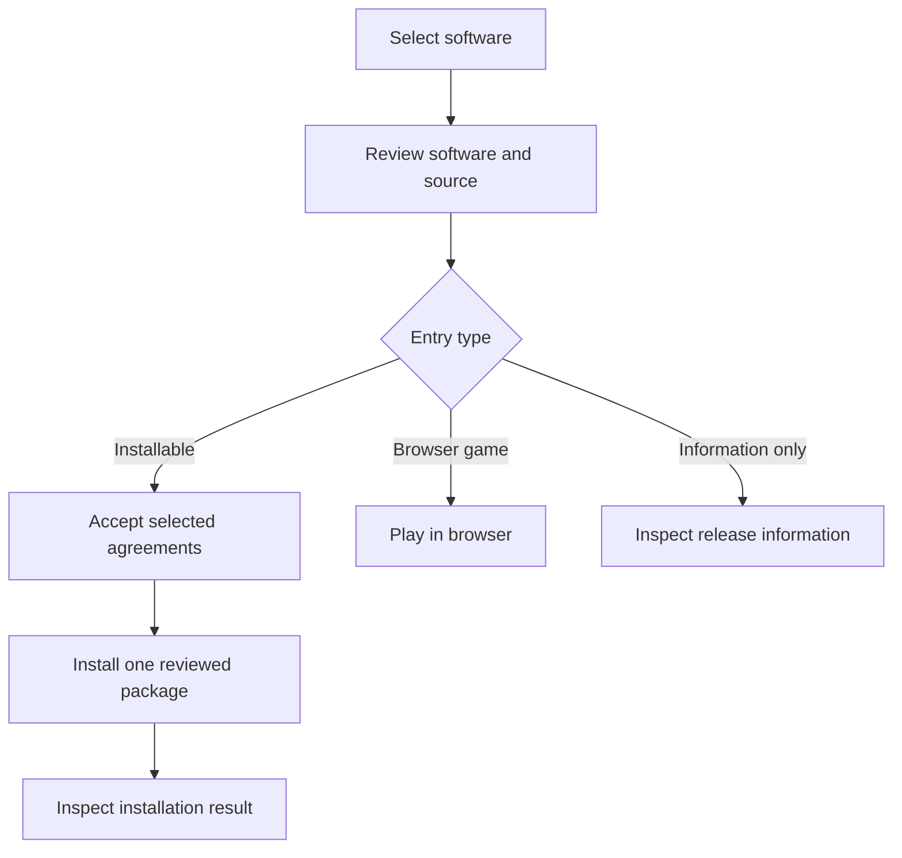

  

  <strong>Windows diagnostics, reviewed maintenance, browsing and productivity in one workspace.</strong> 
  Architecture-grade software production · by <strong>CodeLineCore</strong>

  <a href="https://forge-sentinel.vlmilan24.workers.dev/"><strong>Official website</strong></a>
  &nbsp; · &nbsp;
  <a href="https://github.com/Beans-Melon/Forge-Sentinel-Releases/releases"><strong>⬇ Downloads & release notes</strong></a>
  &nbsp; · &nbsp;
  <a href="#your-first-session">Quick start</a>
  &nbsp; · &nbsp;
  <a href="#find-the-right-tool">Find a tool</a>
  &nbsp; · &nbsp;
  <a href="#questions-before-you-start">FAQ</a>

> **Latest published release: v0.81.9 · Windows x64 · Portable ZIP + installer · Licence required**  
> This repository distributes Forge Sentinel releases. Check each release’s notes for its included features and testing status.

## Understand first. Act with a reason.

A slow PC does not always need a cleaner. It may be busy, low on storage, waiting on a drive, or running too many startup applications. **Forge Sentinel helps you investigate the cause, review the evidence and choose a specific action.**

Watch live resources, investigate storage, review cleanup candidates, verify backups and follow repairs—all inside FS’s own interface. Routine diagnostics and maintenance remain separate, so opening a scan does not silently approve a repair.

## From system care to focused work

| Assess & monitor | Make informed changes | Keep your momentum |
|---|---|---|
| Live PC details, resource graphs, health findings and hardware diagnostics | Reviewed storage cleanup, Windows repair, software and driver updates, security tools | FS Browser, shared downloads, research workspaces and Reminder |

### Browse. Download. Remember.

| FS Browser | Downloads & media | Reminder |
|---|---|---|
| Collapsible tree tabs and website icons; isolated workspaces; adjustable split views; bookmarks; tab hibernation; browser lock; FS Shield | Shared URL input for files, magnets and media review; format selection; transfer scheduling; storage routing; completion audio | Years-to-seconds countdowns, alarms, advance alerts and a pop-out calendar; optional Google Calendar connection |

Media support depends on the source, available formats and the installed extraction tools. Parallel transfer support depends on the protocol and server. v0.81.10 contains a media progress-animation fix in testing; the published download remains v0.81.9.

## Complete capability directory

The same nine groups used on the official website. Expand a category to see every documented capability. **Optional** features need an external service, tool or setup; **Preview** features remain under validation. Availability also depends on the installed release, Windows and hardware.

<strong>Assess & monitor</strong> · 11 capabilities

| Capability | Status | What it does |
|---|---|---|
| **Health Check** | INCLUDED | Opens a read-only assessment of storage, reviewed Windows caches, Defender/signature/scan status, effective firewall profiles, memory, devices, startup and restart indicators, with optional software discovery. Select fixes explicitly and review saved before/after outcomes. |
| **Scan PC** | INCLUDED | Reads Windows, antivirus, firewall, disk-provider status, driver inventory, recent critical events and local network information. It does not repair Windows, clean files or run a malware scan. |
| **Live processes** | INCLUDED | Shows visible processes with CPU, working-set RAM, aggregate I/O, threads and PID. I/O includes file/network/device activity, not network-only bytes. No process is terminated. |
| **Hardware details** | INCLUDED | Shows Windows-reported component models, memory modules, adapter capacities, live per-logical-CPU load and separate read/write/RX/TX rates. Unknown specs remain unavailable; adapter link speed is not internet speed. |
| **Resource Monitor** | INCLUDED | Opens the native FS resource monitor: live CPU/memory, processes, physical-disk counters, adapters and TCP endpoints. Does not launch Windows Resource Monitor or change processes/settings. |
| **Performance recorder** | INCLUDED | Records timestamped OS counters and available sensor-provider data, with charts, bookmarks, process context and exports. No kernel driver is installed. Missing thermal sensors remain unavailable. |
| **Battery status** | INCLUDED | Opens read-only live Windows battery and AC status, battery saver, runtime estimates and per-pack capacity/rate/cycle/temperature fields when reported. Unsupported values remain Unavailable. No charge limit, firmware or power plan is changed. |
| **Drive health** | INCLUDED | Opens structured Windows + SMART/NVMe health, vendor attributes, findings, history, reports and explicit device self-test controls. Collection is read-only but may wake disks. USB/driver support varies; no remaining-life prediction or capacity proof. |
| **External devices** | INCLUDED | Shows present USB/Bluetooth and peripheral functions, driver metadata, Windows error codes and a local observation timeline. USB can be internal; detection is not a successful functional test. Monitoring runs while FS is open. |
| **Startup analyser** | INCLUDED | Inventories selected startup mechanisms, signatures and recorded Windows boot delays. Supports reversible Run/Startup-folder changes; logon tasks and services remain read-only. |
| **Crash investigator** | INCLUDED | Opens configurable event timeline, incident context, XML evidence, driver/update comparisons and dump inspection. Deeper dump analysis uses installed Microsoft cdb.exe with opt-in symbol downloads. Evidence is not an automatic final diagnosis. |

<strong>Storage & protection</strong> · 7 capabilities

| Capability | Status | What it does |
|---|---|---|
| **Disk analyzer** | INCLUDED | Opens read-only logical storage analysis with folder totals, file types and largest-file drill-down. It never deletes files. Exclusions, unreadable paths, hard links and scan limits affect totals. |
| **Duplicate files** | INCLUDED | Opens duplicate review restricted to supported personal assets/static documents and known binary asset formats. Software code, executables/libraries, unknown binary formats and protected system/application paths are excluded. Size, SHA-256 and full byte comparison are used; no files are automatically selected for removal. |
| **Reviewed cache cleaning** | INCLUDED | Opens explicit supported caches and optional old Windows diagnostic evidence categories. Preview first, review category notes, age and exclusions, then confirm permanent cleanup. Crash/WER evidence cannot rebuild like cache. Browser account/history data and documents are excluded. |
| **Windows component cleanup** | INCLUDED | Administrator required. Runs DISM /Online /Cleanup-Image /StartComponentCleanup to remove superseded Windows component versions through Windows servicing. No /ResetBase is used. This may take time; Stop does not terminate the running DISM operation. |
| **Verified file backup** | INCLUDED | Opens file/folder backup with SHA-256 verification, durable partial-copy checkpoints, resume and independent re-verification. Existing different destination files are never overwritten. Main file streams only; no VSS, ACL/ADS or EFS backup. |
| **System backup** | INCLUDED | Opens the Windows system-image workflow. The backup includes Windows and critical boot/recovery volumes, not every separate data drive. Requires administrator rights and a suitable NTFS destination on another physical disk. Opening the panel does not create a backup. |
| **USB capacity / tests** | INCLUDED | Opens USB device details and file-based capacity verification, sequential benchmarks and three-pass sample stress tests. No test starts on opening. |

<strong>System & security</strong> · 10 capabilities

| Capability | Status | What it does |
|---|---|---|
| **DISM → SFC repair** | INCLUDED | Opens stage progress, elapsed times, console output, native log activity and evidence reports. Start requires administrator and confirmation. DISM repairs the Windows component store, normally using Windows Update as a repair source. SFC then checks and repairs protected Windows system files. This does not repair every application or remove malware. Keep power connected and review the results; a restart may be required. |
| **Services** | INCLUDED | Opens the in-app service manager. Refresh is read-only. Core Windows, driver and recognized security services are protected; supported non-system service changes require administrator rights and confirmation. |
| **Software uninstall** | INCLUDED | Opens FS's registered desktop-software inventory and interactive uninstall manager. Windows Store/portable apps may require Windows installed apps or publisher instructions. No automatic leftover deletion. |
| **File reputation** | OPTIONAL | Opens read-only local SHA-256 fingerprinting and reviewed selected-file reputation checks. Online results require CodeLineCore’s configured commercial VirusTotal service; no user API key or file upload. This does not replace Defender. |
| **Password exposure check** | INCLUDED | Checks a manually entered password against the free HIBP Pwned Passwords API. Only the first five locally computed hash characters are sent. Input is cleared; results are session-only. No match does not prove safety. |
| **Windows Security** | INCLUDED | Opens Forge Sentinel's protection center: Defender, registered antivirus and firewall status, signature updates, scans and detection history. No Windows Security window opens. Some functions can be unavailable under third-party protection or organisation policy. |
| **Defender quick** | INCLUDED | Runs Microsoft Defender's quick scan after updating signatures. It checks common infection locations and can quarantine detected threats under your existing security policy. Administrator rights are required by this workflow. |
| **Defender full** | INCLUDED | Runs Defender's full scan after updating signatures. It can take a long time and use CPU/disk resources. Detected threats may be quarantined according to Windows security policy. |
| **Driver updates** | INCLUDED | Opens the driver panel to scan applicable Windows Update packages, review official Catalog/OEM/component source links and install one reviewed, hardware-matched driver after explicit consent. Opening or scanning does not install anything; BIOS/firmware is excluded from installation. |
| **Reviewed broken-uninstaller removal** | INCLUDED | For eligible applications with missing registered EXE uninstallers, preview exact files and shortcuts and separately review app-list cleanup. Protected/shared locations and recognized saves are excluded; this is not universal leftover removal. |

<strong>Apps & updates</strong> · 5 capabilities

| Capability | Status | What it does |
|---|---|---|
| **Get apps** | INCLUDED | Opens the searchable application catalog. Review an exact WinGet package or the dedicated Argus prerequisite/dependency plan before confirming. Nothing is preselected or installed automatically; release-only entries have no installer action. |
| **Software updates** | INCLUDED | Opens WinGet discovery and reviewed selected-application installation. Installation requires a fresh package review and explicit confirmation. No bulk update or driver updating is provided. |
| **142-entry software catalogue** | OPTIONAL | Browse the bundled application and game catalogue by category. Select software, review its publisher terms and availability, then confirm the supported install or launch. Third-party software is not all bundled or included in the FS licence. |
| **Installation review flow** | INCLUDED | Select → Review → Install. Installing a new application does not require closing an application that is not yet installed. Native installer and UAC prompts may appear. |
| **Selected update verification** | INCLUDED | Compare installed/available versions, review one update and verify its outcome. The reviewed KillerPDF fallback covers supported per-user x64 EXE installations; other packages retain WinGet. An available version is not proof an applicable installer exists. |

<strong>Network tools</strong> · 6 capabilities

| Capability | Status | What it does |
|---|---|---|
| **Network & devices** | INCLUDED | Shows local adapters, gateway/router information and visible neighbors. Discovery is user-initiated and limited to supported private subnets. Devices are not identified people, and the list is not the router's complete client inventory. |
| **Open speed test** | INCLUDED | Opens a user-initiated Cloudflare download/upload/HTTPS-latency estimate. Up to 132 MiB plus overhead per test. This is not an ISP line certification and no test runs automatically. |
| **Public information lookup** | OPTIONAL | Opens native IP, public-IP, local phone metadata and public-handle lookup tools. Review the provider disclosure before Search; no live GPS or subscriber tracking. |
| **System design simulator** | OPTIONAL | Opens the optional online Breakscale design simulator. Simulated architecture behavior is not a Windows benchmark or live network load test. |
| **DNS settings** | INCLUDED | Opens adapter DNS inspection, provider comparison and reversible DNS changes. Changing DNS does not increase ISP bandwidth. VPN/office networks may require existing internal resolvers. |
| **Network control** | INCLUDED | Opens upload-only Windows QoS caps and per-executable firewall blocking. No arbitrary-app download shaping is included. Rules are reviewed before changes. |

<strong>Browser & research</strong> · 18 capabilities

| Capability | Status | What it does |
|---|---|---|
| **FS Browser** | INCLUDED | A separate Windows WebView2 browser with an address bar, multiple tabs, bookmarks, history and local project notes. Runs with normal Windows permissions. |
| **Collapsible website-icon rail** | INCLUDED | Collapse the left sidebar into website icons; expand it for titles, previews and parent/child tree branches. Ctrl+Alt+T switches views. |
| **Auto-hibernating tabs** | INCLUDED | Configurable idle suspension for eligible background tabs. Visible panes, media, downloads, edited forms and Keep awake tabs are protected. The runtime can decline suspension. |
| **Tree-tab organization** | INCLUDED | Nest tabs under the page they were opened from; collapse branches, move tabs and keep children when their parent closes. |
| **Adjustable split views** | INCLUDED | Arrange two or three tabs within one window, with adjustable dividers and per-pane tab selection. |
| **Workspace containers** | INCLUDED | Personal, work and project workspaces use separate browser profiles for cookies and sessions. Switch using Ctrl+Alt+Left/Right or Ctrl+Alt+1–9. |
| **FS Shield** | INCLUDED | Request filtering for ads and trackers, popup protection, Standard/Strict modes, per-site pause and filter updates. Some sites or media may require an exception. |
| **URL cleanup & redirects** | INCLUDED | Remove known tracking parameters, resolve supported desktop/AMP links and configure domain redirect rules. Signed links and login tokens are preserved where recognized. |
| **Private link previews** | INCLUDED | Shift-hover, or optional timed hover, opens a muted isolated preview. The destination is contacted without sharing the normal signed-in profile. |
| **Local Markdown clipping** | INCLUDED | Export supported page content to local Markdown, with bounded image downloads for accessible public images. |
| **Clipboard history & smart paste** | INCLUDED | Opt-in, searchable, memory-only clipboard entries and plain-text, formatted JSON or Markdown-link paste. Not a system-wide clipboard recorder. |
| **RSS & Atom reader** | INCLUDED | Add supported feed URLs without a feed-service account. YouTube feeds depend on supported public channel feed URLs. |
| **Page-element change watches** | INCLUDED | Select an element and compare its content on matching loaded pages. Watchers are not an always-on server or a guaranteed stock/price notification service. |
| **Disposable burner tabs** | INCLUDED | Isolated InPrivate tabs are excluded from saved sessions and clipboard capture. Temporary-data removal is best effort after shutdown; burner downloads are disabled. |
| **Tab audio controls** | INCLUDED | Per-tab media volume and supported equalizer presets. Behavior depends on the page, player and cross-origin restrictions. |
| **Background video reduction** | INCLUDED | Optional supported-player video-track reduction while preserving audio. It cannot force every streaming service to send audio-only data. |
| **HTTPS navigation & privacy details** | INCLUDED | FS blocks HTTP navigation and certificate errors. The privacy panel explains transport, local storage and website-input boundaries. |
| **Password / PIN screen lock** | INCLUDED | A blurred interface lock accepts a password or six-digit PIN. Five failed attempts trigger browser shutdown, a retry delay and main-FS cache-cleanup handoff. Not administrator-proof. |

<strong>Downloads & media</strong> · 6 capabilities

| Capability | Status | What it does |
|---|---|---|
| **Shared download manager** | INCLUDED | Review browser transfers and direct HTTP/HTTPS links in one queue. Inspect progress, pause/resume, cancel, schedule and set limits. |
| **Torrent files & magnets** | OPTIONAL | Supported BitTorrent transfers through the optional download engine, with upload limits and bounded optional completion seeding. Only download content you are authorized to obtain. |
| **Automatic storage routing** | INCLUDED | Choose direct storage or eligible separate-SSD staging using bounded drive/source samples. Unknown or unsupported conditions remain direct; staging does not guarantee faster final delivery. |
| **Reviewed video/audio downloads** | OPTIONAL | Send a video link to Downloads, review available MP3, MP4, M4A, WebM or WAV formats, then choose the output. Uses verified yt-dlp 2026.11.23, FFmpeg and Deno. Existing verified dependencies can be reused during an extractor update. Availability depends on the website and stream. |
| **Download completion sound** | INCLUDED | A completion beep is enabled by default and respects FS mute/quiet-hour settings. Reminder sound is configured separately. |
| **Transfer scheduling & limits** | INCLUDED | Schedule eligible transfers, apply download/upload limits and inspect transfer details. Background work requires the helper to remain running. |

<strong>Productivity</strong> · 7 capabilities

| Capability | Status | What it does |
|---|---|---|
| **Reminder** | INCLUDED | A separate window for countdowns in years, months, days, hours, minutes and seconds, scheduled alarms, advance alerts and a pop-out calendar. |
| **Advance reminders** | INCLUDED | Eligible one-hour, thirty-minute and one-minute reminders, plus pause/resume, add time, snooze and cancel. |
| **Page reminders & notifications** | INCLUDED | Attach a page to a reminder, review local notification history and set quiet hours. The running helper is required; a powered-off PC cannot deliver an alert. |
| **Focus sessions** | INCLUDED | Use time-bound focus controls and site pauses inside FS Browser. |
| **Google Calendar connection** | OPTIONAL | Connect a Desktop OAuth client, authorize read-only Calendar access and link a reminder to a Google event start or end time. Requires Google Calendar API setup and user consent. |
| **Gmail metadata & alerts** | OPTIONAL | Optional sender/subject synchronization, sender filtering and preview privacy controls. Polling is not guaranteed real-time email delivery. |
| **Veylo encrypted vault** | PREVIEW | Veylo 0.29 integrated in a dedicated local window. Reviewed exact-HTTPS-origin filling, deliberate save/update and encrypted .vvlt import/export. Independent FS store; standalone phone/Wi-Fi sync and Chrome cloud-password sync are not enabled. Use test accounts until Windows acceptance is complete. |

<strong>Control & evidence</strong> · 8 capabilities

| Capability | Status | What it does |
|---|---|---|
| **Maintenance schedules** | INCLUDED | Prepare reviewed task rules, scopes and recurring times. Eligibility and permissions are checked before dispatch; schedules do not authorize unrelated changes. |
| **Session export & history** | INCLUDED | Export activity, inspect maintenance history and review saved evidence. Check file paths and identifying details before sharing a report. |
| **Offline help** | INCLUDED | Search the included offline guide library and get action-specific descriptions through hover or F1. No AI API key is needed for offline guidance. |
| **Tray & startup controls** | INCLUDED | Keep the application in the tray, configure supported Windows sign-in startup and choose hidden startup. |
| **Reviewed changes** | INCLUDED | Cleaning, installation, updating and other write operations use their own review and confirmation. Opening a tool does not approve its changes. |
| **Device-bound licensing** | INCLUDED | A publisher-issued licence activates maintenance access. Background authorization checks and expiry/revocation rules apply; licence duration is shown in the UI. |
| **Error-report controls** | INCLUDED | Manage automatic error reporting in Settings. Raw logs, exception messages and filenames remain local under the implemented reporting policy. |
| **Browser startup diagnostics** | INCLUDED | A startup failure shows a local, copyable exception type and stack trace for troubleshooting; this diagnostic panel does not upload automatically. |

## Your first session

1. **Download** the Windows package from [Releases](https://github.com/Beans-Melon/Forge-Sentinel-Releases/releases). Use the uploaded FS ZIP or Setup executable; GitHub’s automatically generated **Source code** archives are not the Windows application.
2. **Install or extract.** Run Setup for an installed copy, or extract the complete portable ZIP to a writable folder and launch `Forge-Sentinel.exe`. No Python or separate .NET installation is required for the supplied Windows build.
3. Open **Licence / activation** and activate your licence. Internet access is needed for online licensing; some maintenance actions also require administrator access.
4. Start with **START → Health Check** or **Scan PC**. `Scan PC` collects status and inventory; repairs are separate actions.
5. Review findings, choose the work you want and inspect the outcome. Use **Export session** or **History / logs** when you need a record.

### From a finding to a fix

## Find the right tool

Tool locations can vary by installed build. This overview groups maintenance tools by purpose; see the complete directory above for browser, downloads and productivity capabilities.

| Tab | What you can do | Buttons to look for |
|---|---|---|
| **START** | Assess the PC and plan recurring maintenance | **Health Check**, **Scan PC**, **Maintenance schedules** |
| **STORAGE** | Explain disk usage, review cleanup and protect files | **Disk analyzer**, **Duplicate files**, **Reviewed cache cleaning**, **Windows component cleanup**, **Verified file backup**, **System backup** |
| **SYSTEM** | Investigate startup and crashes; maintain software and Windows | **Startup analyser**, **Crash investigator**, **DISM → SFC repair**, **Software updates**, **Get apps**, **Software uninstall**, **Services** |
| **SYSTEM → Security** | Access Windows protection and request scans | **Windows Security**, **Defender quick**, **Defender full** |
| **DEVICES** | Inspect connected hardware, power, drives and live performance | **External devices**, **Driver updates**, **Drive health**, **Battery status**, **Resource Monitor**, **Performance recorder**, **USB capacity / tests** |
| **NETWORK** | Inspect connections, configure supported settings and transfer files | **Network & devices**, **Open speed test**, **DNS settings**, **Network control**, **Download manager** |
| **ABOUT** | Check the app version and look for an FS release | **About Forge Sentinel → Check for updates** |

**Need help with a button?** Hover over it, or focus it and press **F1**. Global controls include **Settings**, **Licence / activation**, **Stop after current step**, **Export session** and **History / logs**.

## Useful work, with visible evidence

### 🖥️ See what the PC is doing

- **Resource Monitor:** FS’s own live overview for CPU, memory, GPU, disk, network and busy processes, with detailed tabs and report exports.
- **Performance recorder:** Capture a session with resource samples, available sensor readings, bookmarks and summaries for later comparison.
- **Battery status:** Check charge and AC status, reported capacity, estimated battery health, cycles and other supported readings. Export a snapshot or create a Windows battery report.
- **External devices:** Inspect connected devices, reported identifiers and Windows problem information.

Unsupported readings appear as unavailable. GPU data has its own sampling cadence; a displayed reading is not necessarily from the same instant as every other tile. Battery health is a reported capacity estimate, not a prediction of remaining service life.

### 🗂️ Make storage decisions with context

- **Disk analyzer:** Find large folders and understand logical file sizes. Logical size is not a promise of recoverable disk space.
- **Reviewed cache cleaning:** Inspect categories, exclusions and a preview before approving cleanup. Applications may rebuild caches afterward.
- **Duplicate files:** Compare supported personal assets and static files by size, SHA-256 and full byte comparison. Source code, executables, DLLs and other excluded content stay outside this scope. Nothing is selected automatically; a keeper is protected, and approved copies go to the Recycle Bin.
- **Live scan activity:** Disk analyzer and Duplicate files show actual stages and counters with an optional pulsing display. These are task readings, not a physical disk-sector map or simulated progress.

### 🛡️ Protect data and maintain Windows

**Verified file backup** checks destination content with SHA-256 and supports resumable work. **System backup** provides a separate Windows-backed backup workflow. Keep important backups on another physical drive.

Use **DISM → SFC repair** for the supported Windows repair workflow, **Startup analyser** to investigate startup entries, and **Crash investigator** to collect relevant event and dump evidence. Windows Defender performs the antivirus scans requested through FS.

The USB tools include capacity tests, safe-eject assistance, reviewed advanced fallback options and basic recovery workflows. Capacity testing writes test data: use an empty, backed-up drive. Recovery is limited to supported signature candidates such as JPEG, PNG and PDF; original names, folder structures and recovery after overwriting or TRIM are not guaranteed.

## Get apps without losing your place

**SYSTEM → Get apps** brings the reviewed catalog into a simple sequence. Entries include browsers, archives, media tools, productivity software, developer utilities and entertainment. Logos help you recognise the choices.

Installations use supported, reviewed package workflows; installer or administrator prompts may appear. Browser games open externally and may require their own game files. GitHub release inspection shows metadata—it does not automatically execute an arbitrary release asset. Third-party licences, accounts and charges still apply.

**Software updates** handles supported application-update discovery and reviewed updates. **Driver updates** provides discovery and source information; it does not automatically install every driver or flash BIOS firmware.

## Work in the background

FS can continue supported tasks while its window is hidden. Closing the main window normally sends it to the notification area. Restore it from the tray icon, or use the tray menu’s **Exit** command when you want to close FS completely.

Task completion can show a small notification. Use **Mute task sound** to silence completion audio. **Settings** includes supported startup options, and **Maintenance schedules** lets you configure explicit recurring rules.

To stop work, use the relevant cancellation control or **Stop after current step**. Wait for the task’s outcome; hiding the window does not cancel it.

## Updates and activation

1. Finish active tasks and exit the old copy through its tray menu.
2. Download the new package from this repository’s [Releases](https://github.com/Beans-Melon/Forge-Sentinel-Releases/releases).
3. Run the new installer, or extract the complete new portable package and launch its EXE.
4. Check the version in the title bar or About window.

Activation is designed to remain available across updates on the **same PC and Windows user profile**. Another profile may need the key entered again; substantial hardware identity changes or a Windows reinstall may require an administrator reset. The licence window shows remaining licence time.

The in-app update flow checks eligible stable GitHub releases, lets you review and confirm the update, then downloads and verifies the selected package. Finish active tasks before upgrading. Preview releases may not be offered as stable updates.

## Questions before you start

| Question | Answer |
|---|---|
| Will FS automatically make every PC faster? | No. Improvements depend on the cause. Use measurements and findings to decide what needs attention. |
| Is it completely offline? | No. Licensing, release checks, software downloads and selected network tools contact online services. Many local diagnostics operate on the PC itself. |
| What should I check before sharing a report? | Reports can contain paths, hardware identifiers, process details, network information or battery history. Review the exported file first. |
| Does uninstall mean every trace is removed? | No. FS uses supported uninstallers and reviewed cleanup options. Shared components and protected system content require care. |
| Does it replace a backup or guarantee recovery? | No. Keep independent backups. Recovery results depend on the device and what happened to the data. |
| Why might Windows say “Unknown publisher”? | The documented preview EXE is unsigned. Obtain it from the intended release and compare its published checksum when supplied. |
| Is this repository an open-source licence for FS? | No. A public download repository does not grant source-code or redistribution rights. See the terms included with the release. |

## Preview status and feedback

The v0.81.9 verification record reports **439 automated checks**. v0.81.10 remains a test package for the media progress-animation fix. Native Windows hardware, UI/DPI behaviour, installer/uninstaller acceptance and every third-party package still require Windows testing. A passing automated check is not a guarantee that every device or installer has been validated.

Found a problem? Include your **FS version**, Windows version, the **exact button pressed**, expected result and actual result. Attach reviewed logs or a screenshot where helpful. **Never include a licence key or administrator token in a public report.**

---

  <strong>FORGE SENTINEL · by CodeLineCore</strong> 
  Architecture-grade software production  
  <a href="https://forge-sentinel.vlmilan24.workers.dev/">Visit the official website →</a> · <a href="https://github.com/Beans-Melon/Forge-Sentinel-Releases/releases">Explore releases →</a>

