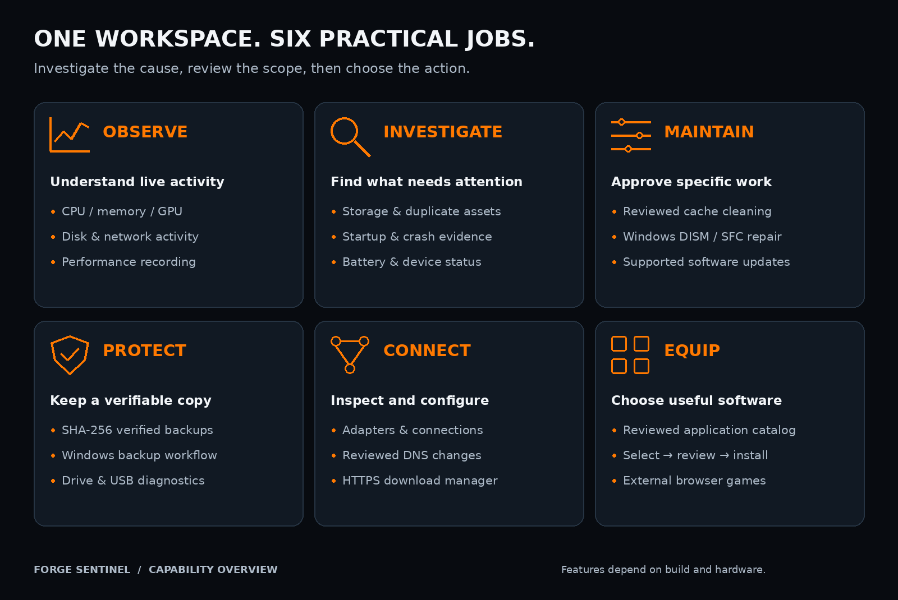
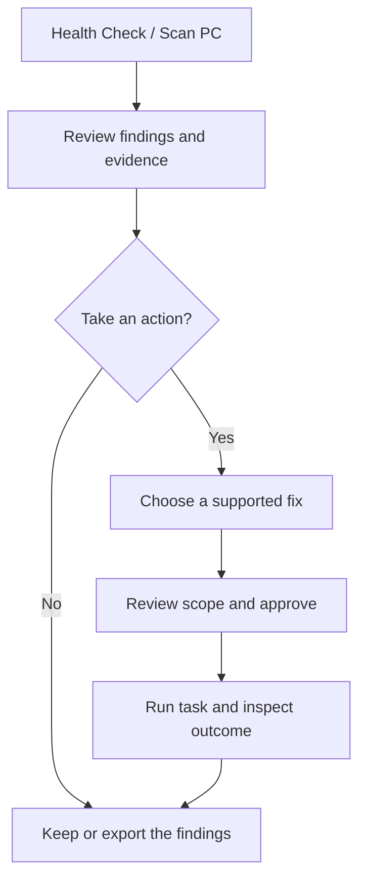
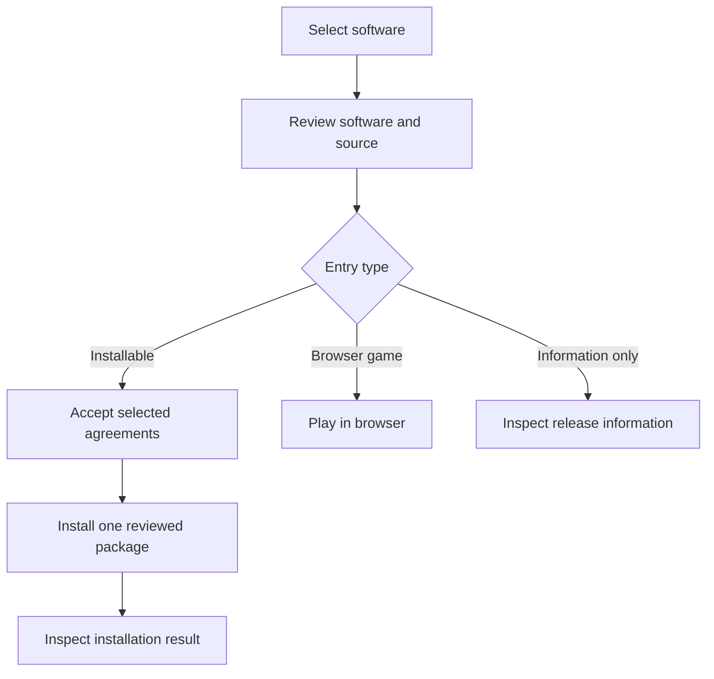

  

  <strong>Windows maintenance, diagnostics and reviewed actions in one workspace.</strong> 
  Architecture-grade software production · by <strong>CodeLineCore</strong>

  <a href="https://github.com/Beans-Melon/Forge-Sentinel-Releases/releases"><strong>⬇ Downloads & release notes</strong></a>
  &nbsp; · &nbsp;
  <a href="#your-first-session">Quick start</a>
  &nbsp; · &nbsp;
  <a href="#find-the-right-tool">Find a tool</a>
  &nbsp; · &nbsp;
  <a href="#questions-before-you-start">FAQ</a>

> **Documented build: v0.44 preview · Windows x64 · Portable ZIP + installer · Licence required**  
> This repository distributes Forge Sentinel releases. Check each release’s notes for its included features and testing status.

## Understand first. Act with a reason.

A slow PC does not always need a cleaner. It may be busy, low on storage, waiting on a drive, or running too many startup applications. **Forge Sentinel helps you investigate the cause, review the evidence and choose a specific action.**

Watch live resources, investigate storage, review cleanup candidates, verify backups and follow repairs—all inside FS’s own interface. Routine diagnostics and maintenance remain separate, so opening a scan does not silently approve a repair.

## Your first session

1. **Download** the Windows package from [Releases](https://github.com/Beans-Melon/Forge-Sentinel-Releases/releases). Use the uploaded FS ZIP or Setup executable; GitHub’s automatically generated **Source code** archives are not the Windows application.
2. **Install or extract.** Run Setup for an installed copy, or extract the complete portable ZIP to a writable folder and launch `Forge-Sentinel.exe`. No Python or separate .NET installation is required for the supplied Windows build.
3. Open **Licence / activation** and activate your licence. Internet access is needed for online licensing; some maintenance actions also require administrator access.
4. Start with **START → Health Check** or **Scan PC**. `Scan PC` collects status and inventory; repairs are separate actions.
5. Review findings, choose the work you want and inspect the outcome. Use **Export session** or **History / logs** when you need a record.

### From a finding to a fix

## Find the right tool

The names below match the v0.44 main navigation. Availability can depend on Windows, hardware, permissions and the installed build.

| Tab | What you can do | Buttons to look for |
|---|---|---|
| **START** | Assess the PC and plan recurring maintenance | **Health Check**, **Scan PC**, **Maintenance schedules** |
| **STORAGE** | Explain disk usage, review cleanup and protect files | **Disk analyzer**, **Duplicate files**, **Reviewed cache cleaning**, **Windows component cleanup**, **Verified file backup**, **System backup** |
| **SYSTEM** | Investigate startup and crashes; maintain software and Windows | **Startup analyser**, **Crash investigator**, **DISM → SFC repair**, **Software updates**, **Get apps**, **Software uninstall**, **Services** |
| **SYSTEM → Security** | Access Windows protection and request scans | **Windows Security**, **Defender quick**, **Defender full** |
| **DEVICES** | Inspect connected hardware, power, drives and live performance | **External devices**, **Driver updates**, **Drive health**, **Battery status**, **Resource Monitor**, **Performance recorder**, **USB capacity / tests** |
| **NETWORK** | Inspect connections, configure supported settings and transfer files | **Network & devices**, **Open speed test**, **DNS settings**, **Network control**, **Download manager** |
| **ABOUT** | Check the app version and look for an FS release | **About Forge Sentinel → Check for updates** |

**Need help with a button?** Hover over it, or focus it and press **F1**. Global controls include **Settings**, **Licence / activation**, **Stop after current step**, **Export session** and **History / logs**.

## Useful work, with visible evidence

### 🖥️ See what the PC is doing

- **Resource Monitor:** FS’s own live overview for CPU, memory, GPU, disk, network and busy processes, with detailed tabs and report exports.
- **Performance recorder:** Capture a session with resource samples, available sensor readings, bookmarks and summaries for later comparison.
- **Battery status:** Check charge and AC status, reported capacity, estimated battery health, cycles and other supported readings. Export a snapshot or create a Windows battery report.
- **External devices:** Inspect connected devices, reported identifiers and Windows problem information.

Unsupported readings appear as unavailable. GPU data has its own sampling cadence; a displayed reading is not necessarily from the same instant as every other tile. Battery health is a reported capacity estimate, not a prediction of remaining service life.

### 🗂️ Make storage decisions with context

- **Disk analyzer:** Find large folders and understand logical file sizes. Logical size is not a promise of recoverable disk space.
- **Reviewed cache cleaning:** Inspect categories, exclusions and a preview before approving cleanup. Applications may rebuild caches afterward.
- **Duplicate files:** Compare supported personal assets and static files by size, SHA-256 and full byte comparison. Source code, executables, DLLs and other excluded content stay outside this scope. Nothing is selected automatically; a keeper is protected, and approved copies go to the Recycle Bin.
- **Live scan activity:** Disk analyzer and Duplicate files show actual stages and counters with an optional pulsing display. These are task readings, not a physical disk-sector map or simulated progress.

### 🛡️ Protect data and maintain Windows

**Verified file backup** checks destination content with SHA-256 and supports resumable work. **System backup** provides a separate Windows-backed backup workflow. Keep important backups on another physical drive.

Use **DISM → SFC repair** for the supported Windows repair workflow, **Startup analyser** to investigate startup entries, and **Crash investigator** to collect relevant event and dump evidence. Windows Defender performs the antivirus scans requested through FS.

The USB tools include capacity tests, safe-eject assistance, reviewed advanced fallback options and basic recovery workflows. Capacity testing writes test data: use an empty, backed-up drive. Recovery is limited to supported signature candidates such as JPEG, PNG and PDF; original names, folder structures and recovery after overwriting or TRIM are not guaranteed.

## Get apps without losing your place

**SYSTEM → Get apps** brings the reviewed catalog into a simple sequence. Entries include browsers, archives, media tools, productivity software, developer utilities and entertainment. Logos help you recognise the choices.

Installations use supported, reviewed package workflows; installer or administrator prompts may appear. Browser games open externally and may require their own game files. GitHub release inspection shows metadata—it does not automatically execute an arbitrary release asset. Third-party licences, accounts and charges still apply.

**Software updates** handles supported application-update discovery and reviewed updates. **Driver updates** provides discovery and source information; it does not automatically install every driver or flash BIOS firmware.

## Work in the background

FS can continue supported tasks while its window is hidden. Closing the main window normally sends it to the notification area. Restore it from the tray icon, or use the tray menu’s **Exit** command when you want to close FS completely.

Task completion can show a small notification. Use **Mute task sound** to silence completion audio. **Settings** includes supported startup options, and **Maintenance schedules** lets you configure explicit recurring rules.

To stop work, use the relevant cancellation control or **Stop after current step**. Wait for the task’s outcome; hiding the window does not cancel it.

## Updates and activation

1. Finish active tasks and exit the old copy through its tray menu.
2. Download the new package from this repository’s [Releases](https://github.com/Beans-Melon/Forge-Sentinel-Releases/releases).
3. Run the new installer, or extract the complete new portable package and launch its EXE.
4. Check the version in the title bar or About window.

Activation is designed to remain available across updates on the **same PC and Windows user profile**. Another profile may need the key entered again; substantial hardware identity changes or a Windows reinstall may require an administrator reset. The licence window shows remaining licence time.

**Update notifications do not install FS automatically.** The release checker looks for eligible stable GitHub releases; a preview release may not be offered as the latest stable update.

## Questions before you start

| Question | Answer |
|---|---|
| Will FS automatically make every PC faster? | No. Improvements depend on the cause. Use measurements and findings to decide what needs attention. |
| Is it completely offline? | No. Licensing, release checks, software downloads and selected network tools contact online services. Many local diagnostics operate on the PC itself. |
| What should I check before sharing a report? | Reports can contain paths, hardware identifiers, process details, network information or battery history. Review the exported file first. |
| Does uninstall mean every trace is removed? | No. FS uses supported uninstallers and reviewed cleanup options. Shared components and protected system content require care. |
| Does it replace a backup or guarantee recovery? | No. Keep independent backups. Recovery results depend on the device and what happened to the data. |
| Why might Windows say “Unknown publisher”? | The documented preview EXE is unsigned. Obtain it from the intended release and compare its published checksum when supplied. |
| Is this repository an open-source licence for FS? | No. A public download repository does not grant source-code or redistribution rights. See the terms included with the release. |

## Preview status and feedback

The v0.44 verification record reports **38 suites and 1,155 assertions** covering policy, models and source integration. Native Windows hardware, UI/DPI behaviour, installer/uninstaller acceptance and every third-party package still require Windows testing. A passing automated check is not a guarantee that every device or installer has been validated.

Found a problem? Include your **FS version**, Windows version, the **exact button pressed**, expected result and actual result. Attach reviewed logs or a screenshot where helpful. **Never include a licence key or administrator token in a public report.**

---

  <strong>FORGE SENTINEL · by CodeLineCore</strong> 
  Architecture-grade software production  
  <a href="https://github.com/Beans-Melon/Forge-Sentinel-Releases/releases">Explore releases →</a>

